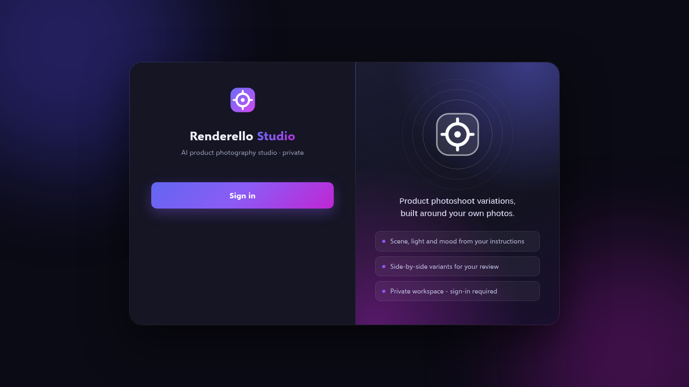
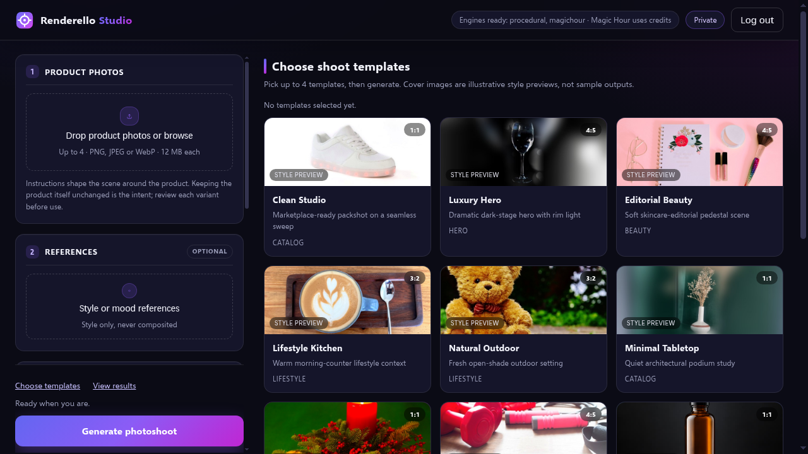
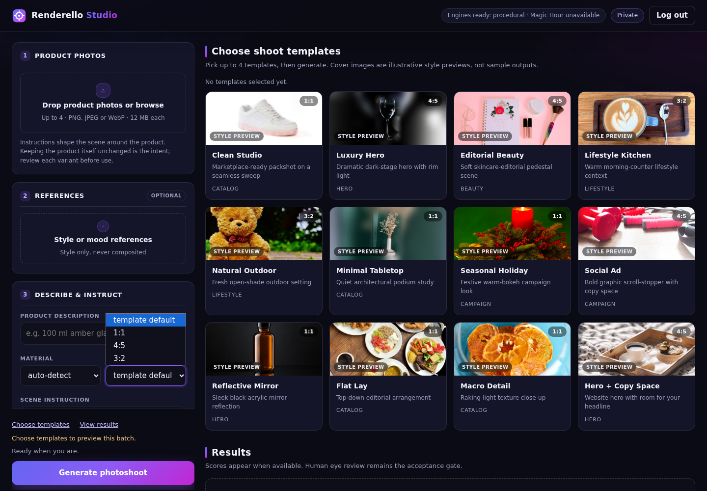
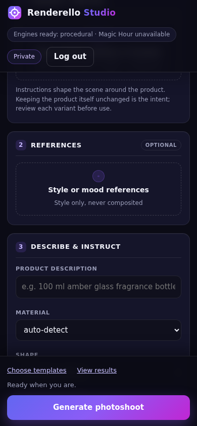
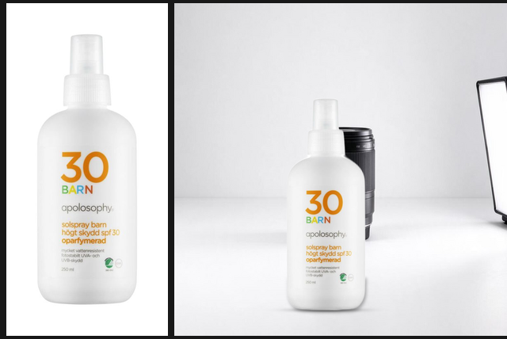

<div align="center">

# Renderello

### Renderello is an AI product photography studio: upload real product photos, pick from twelve researched shoot templates, and get candidate shoot variants where the scene, light and mood are generated around the product while fully opaque product pixels are preserved bit-exact.

[](https://www.python.org/)
[](https://fastapi.tiangolo.com/)
[](https://jupyter.org/)

<p align="center">
  <a href="https://renderello-studio.onrender.com/"><strong>Live studio</strong></a>
  &nbsp;·&nbsp;
  <a href="https://github.com/yogitaranwa?tab=repositories"><strong>More projects</strong></a>
</p>

</div>

---

## Overview

**Renderello** pairs a **FastAPI** web studio with a **self-contained Colab notebook** that runs the same pipeline. Product photos go in; the product is cut out and verified, a scene is built around it from a researched prompt and your instructions, and fully opaque product pixels are composited back bit-exact. Semi-transparent edges and mask quality stay subject to human review, so the results are candidates to review, not guaranteed listing-ready shots. A free procedural CPU engine works offline; the optional **Magic Hour** engine generates AI scenes through a guarded, budget-capped bridge.

### Live Deployment

| Surface            | URL                                                                                                            |
| :----------------- | :------------------------------------------------------------------------------------------------------------- |
| **Studio web app** | [https://renderello-studio.onrender.com](https://renderello-studio.onrender.com) _(private, sign-in required)_ |

### Documentation & Resources

- **Technical Documentation**: Architecture, security model, API reference and deployment guide: **[docs/TECHNICAL_DOCUMENTATION.md](docs/TECHNICAL_DOCUMENTATION.md)**, with working documents beside it (`ARCHITECTURE.md`, `FLOW.md`, `DECISIONS.md`, `CONSTRAINTS.md`, `TESTING.md`, `ROLLBACK.md`, `HANDOVER.md`).
- [**Canva Output Comparison Board**](https://www.canva.com/design/DAHac7bhPSE/pZrqa53pS4c0kIfkpWlGiQ/edit): Daily source/output comparisons

---

## Problem

Small sellers need studio-grade product photos without a studio. Generic image generators redraw the product itself: labels warp, logos drift, proportions change, and the result cannot go on a real listing. The usable middle ground is a tool that changes everything _around_ the product and leaves fully opaque product pixels bit-exact.

---

## Solution

Renderello keeps generation away from the product. The pipeline separates the product from its background, generates only the empty scene (procedurally or via an AI provider), then composites the original product pixels back. Every variant is reviewable side by side with the source photo, and human review remains the acceptance gate.

| Piece                    | What it does                                                                                                                                                 |
| :----------------------- | :----------------------------------------------------------------------------------------------------------------------------------------------------------- |
| **Web studio**           | Sign-in, upload up to 4 product photos plus optional style references, pick up to 4 shoot templates, tune per-template options, generate and review variants |
| **Colab notebook**       | The full pipeline in one notebook: same engines, same presets, plus batch runs and detailed manifests                                                        |
| **Procedural engine**    | Free, offline CPU scene builder (gradients, podiums, shadows, reflections)                                                                                   |
| **Magic Hour engine**    | Optional paid AI scenes via a guarded bridge: explicit spend confirmation, per-run estimates, durable credit budget                                          |
| **Product preservation** | Cutout verification and bit-exact compositing of fully opaque product pixels (edges and mask semantics are the known exclusion, see the technical doc)       |

---

## Key Features

- **Twelve researched shoot templates**: catalog, hero, lifestyle, beauty and campaign scenes, each with a detailed commercial-brief prompt and per-template options (aspect ratio, material, scene instructions).
- **Product-first compositing**: fully opaque product pixels are composited bit-exact onto the generated scene; edges and mask semantics are reviewed by eye, not guaranteed.
- **Guarded paid generation**: Magic Hour calls need a typed spend confirmation, show the credit estimate first, and count against a durable 1,000-credit budget. The bridge is off by default.
- **Private by default**: sign-in required, sessions expire after 12 h, rate-limited login, strict content security policy, one generation job at a time.
- **Honest review flow**: variants appear side by side with the source photo; preview covers are labelled as style previews, not sample outputs.

---

## Screenshots

<p align="center">
  
  
</p>
<p align="center">
  
  
</p>

_The login and studio shots are the live deployed site. The template-options and mobile shots show the local development instance (note the "Magic Hour unavailable" badge), included to show the options UI and mobile layout._

**Input → output.** A real product photo (left) and the Magic Hour scene-compose result (right): the background was generated, the product cutout was preserved and composited. This shows the route working on one verified run; it is not a quality guarantee for every product or scene.

<p align="center">
  
</p>

---

## Repository Layout

```
Renderello/
├── Renderello_Studio.ipynb          # Self-contained Colab notebook (clean, unrun)
├── renderello/                      # Core pipeline: presets, matting, compositing, providers
├── webapp/                          # FastAPI studio (auth, generation API, frontend)
├── tests/                           # Test suite (3,913 passed, 6 skipped at the 21 Nov 2026 checkpoint)
├── benchmark/                       # Benchmark harness and sources
├── research/                        # Research scratch code
├── scripts/                         # Capture and build utilities
├── outputs/                         # Existing-results gallery (see outputs/README.md)
├── docs/
│   ├── TECHNICAL_DOCUMENTATION.md   # Deep reference
│   ├── ARCHITECTURE.md / FLOW.md / DECISIONS.md / CONSTRAINTS.md / TESTING.md / ROLLBACK.md / HANDOVER.md
│   ├── screenshots/                 # Real website and input/output captures
│   ├── Renderello_Studio_LIVE_magichour.ipynb  # Executed notebook (retained outputs)
│   └── ...                          # Research and verification notes
└── requirements.txt                 # Web app dependencies (pinned)
```

---

## Tech Stack

| Area                      | Choice                                                                                          |
| :------------------------ | :---------------------------------------------------------------------------------------------- |
| **Runtime**               | Python 3.14 (web app), Colab CPU/GPU runtimes (notebook)                                        |
| **Web stack**             | FastAPI, uvicorn, vanilla JS frontend, Pillow                                                   |
| **AI providers**          | Procedural engine (built in), Magic Hour API (optional, paid), SDXL Lightning config (notebook) |
| **Matting / compositing** | Custom pipeline with PyMatting (MIT), onnxruntime                                               |
| **Hosting**               | Render free web service, Google Colab                                                           |

Pinned versions: **`requirements.txt`** (38 packages, locked to the deployed build's resolved set).

---

## Colab Notebooks

- **`Renderello_Studio.ipynb`**: the clean, unrun notebook. Run all, then follow the sections in order. On a fresh runtime the dependency-check cell may restart the kernel; run everything again if that happens. Colab can migrate or restart the VM more than once, so repeating Run all may be needed until a run completes.
- **`docs/Renderello_Studio_LIVE_magichour.ipynb`**: an executed copy with retained outputs from the first verified Magic Hour run through the hosted bridge (one 30-credit image, background generated, product preserved). Execution counts are not recorded in this copy, so it is evidence of the run, not a sequentially counted full run-all.

---

## Current Limitations

- The studio runs on a free host: one generation job at a time, generated files are stored on ephemeral instance storage, and long-running reliability is not yet proven.
- Magic Hour generation spends credits from a fixed budget and stays off unless explicitly enabled and confirmed per run.
- Product preservation covers fully opaque pixels; semi-transparent edges and mask semantics are reviewed by eye, not guaranteed.
- Cover images in the template picker are illustrative style previews, not sample outputs.

---

## Third-Party Notices

- **[PyMatting](https://github.com/pymatting/pymatting/)** (MIT): CF/LKM matting and foreground estimation; guided filter per He, Sun and Tang (ECCV 2010).
- **BiRefNet** (MIT): default cutout backend. rembg informed the input normalization approach. onnxruntime runs local models.
- **SDXL Lightning configuration** is used under the CreativeML OpenRAIL-M license (`docs/CreativeML-OpenRAIL-M.txt`); see `docs/MODEL_LICENSE_REVIEW.md`.
- **Magic Hour** is a paid external API used under its own terms.
- **Stock photo sources** used in research are listed in the research notes.

---

## Author

**[Yogita Kumari](mailto:yogita2004ranwa@gmail.com)** · _B.Tech. CSE, IIIT Manipur (2023–2027)_

<p align="left">
  <a href="https://www.linkedin.com/in/yogita-kumari7"></a>
  <a href="https://yogitakumari.vercel.app"></a>
  <a href="https://www.instagram.com/my_graphites_grit"></a>
</p>

---

<div align="center">

Made with devotion🤍 for sellers who deserve studio-grade photos.<br />
**Yogita Kumari**

</div>
